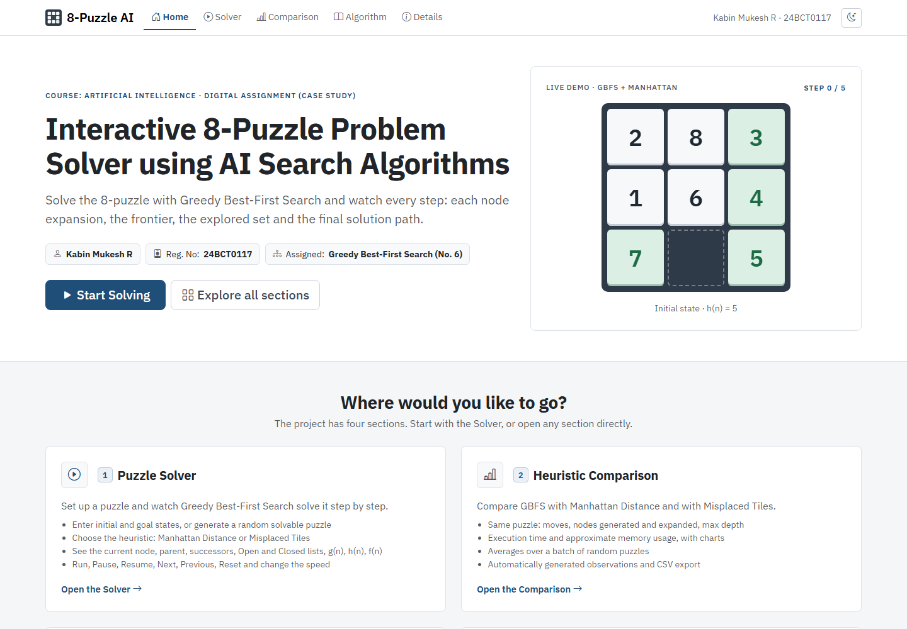
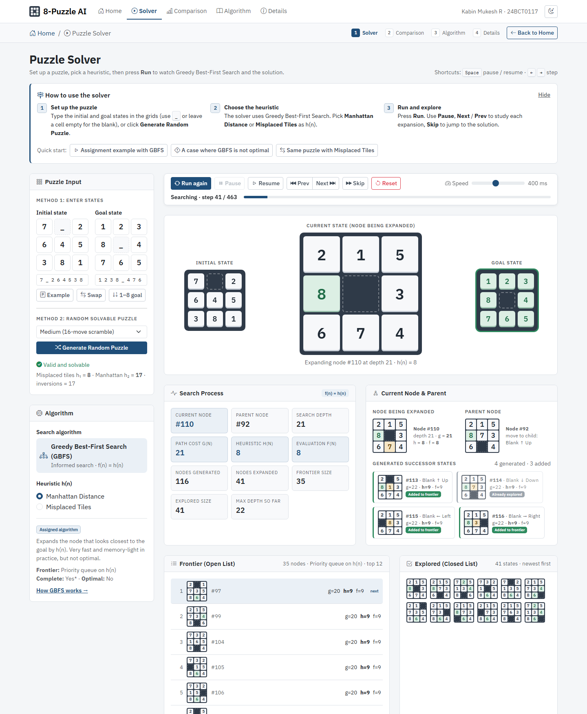
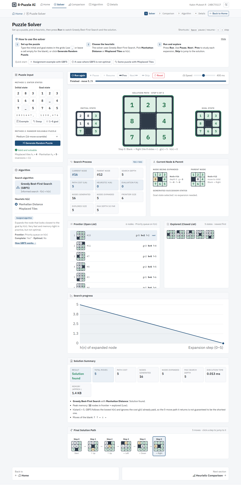
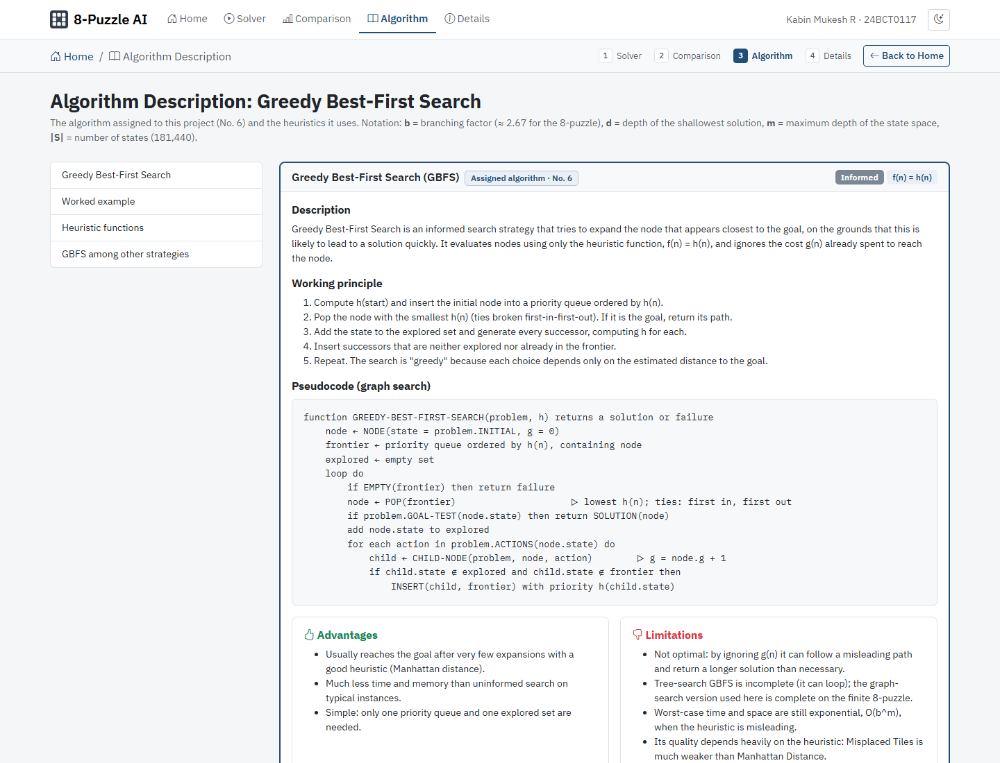

# AI 8-Puzzle Visualizer

**Interactive 8-Puzzle Problem Solver using AI Search Algorithms**
Artificial Intelligence · Digital Assignment (Case Study)

| | |
|---|---|
| **Student** | Kabin Mukesh R |
| **Registration No.** | 24BCT0117 |
| **Assigned algorithm** | **No. 6: Greedy Best-First Search (GBFS)** |
| **Live website** | https://ai-puzzle-solver.vercel.app (Vercel) |
| **Repository** | https://github.com/Kabin07/AI_Puzzle_solver |

---

## Project Description

This is a web application that models the **8-puzzle** as a state-space search problem and solves it with the algorithm assigned to me, **Greedy Best-First Search (GBFS)**, implemented from scratch in JavaScript. It uses the **Misplaced Tiles** and **Manhattan Distance** heuristics.

The app does more than print an answer: it animates the search one expansion at a time. For each step you can see the node being expanded, its parent, the successors it generated, the Open list (frontier, ordered by h(n)), the Closed list (explored set), the current depth, and g(n), h(n) and f(n) = h(n). After the search, the blank-tile moves along the final solution path are animated.

### Features

| Requirement | Where |
|---|---|
| Home page with course, title, student name, registration number, 8-puzzle introduction and navigation. It is the single entry point, with cards for every section and quick-start links | `index.html` |
| Puzzle input, Method 1: enter initial and goal states (3×3 grid or one line of text) | Solver / Comparison, left panel |
| Puzzle input, Method 2: **Generate Random Puzzle** (always solvable; 4 difficulty levels) | Solver / Comparison, left panel |
| Assigned algorithm: Greedy Best-First Search | Solver, "Algorithm" card |
| Heuristic selection: **Misplaced Tiles** and **Manhattan Distance** | Solver, "Algorithm" card |
| Visualisation of initial, goal and current state, generated successors and final solution path, with animated blank movement | Solver |
| Real-time search info: current node, nodes generated and expanded, frontier, explored, depth, parent, path cost, plus h(n), g(n), f(n) | Solver, "Search Process" and related cards |
| Solution summary: found or not, moves, generated, expanded, max depth, execution time, path cost, approximate memory | Solver, "Solution Summary" |
| Performance comparison: GBFS with both heuristics on the same puzzle and averaged over random puzzles, with charts, observations and CSV export | `compare.html` |
| Algorithm information: description, working principle, pseudocode, advantages, limitations, time and space complexity, completeness, optimality, worked example | `algorithms.html` |
| Project details: problem formulation, step-by-step user guide, features, technologies, structure, references | `details.html` |
| Controls: **Run, Pause, Resume, Next Step, Previous Step, Reset, Change Speed** (plus Skip and keyboard shortcuts) | Solver, controls bar |
| Easy navigation: the same menu on every page, plus a breadcrumb, numbered section steps, a Back to Home button and Previous / Next section links | All pages |
| Responsive layout, light and dark mode, keyboard accessible | All pages |

## Screenshots

| Home | Solver: search in progress |
|---|---|
|  |  |

| Solver: summary and solution path | Heuristic comparison |
|---|---|
|  |  |



## Technologies Used

- **HTML5** and **CSS3** (CSS custom properties, container queries, transitions)
- **JavaScript (ES6+)**: classes, arrow functions, destructuring, template literals, `Map` / `Set`. No build step and no frameworks.
- **Bootstrap 5.3** (UI framework, responsive grid, colour modes) and **Bootstrap Icons**, loaded from the jsDelivr CDN
- **SVG** for charts, drawn by hand in `js/ui/charts.js` with no chart library
- **GitHub Pages** for hosting

## Search Algorithm Implemented: Greedy Best-First Search

| Property | Value |
|---|---|
| Type | Informed (heuristic) search |
| Evaluation function | **f(n) = h(n)** |
| Frontier | Min-priority queue (binary heap) ordered by h(n); ties broken first-in-first-out |
| Version | Graph search (explored set); goal test when a node is selected for expansion |
| Complete | Yes on the finite 8-puzzle state space (graph search) |
| Optimal | **No**: it ignores the path cost g(n) |
| Time / space | O(b^m) in the worst case; usually very small with a good heuristic |
| Source | [`js/algorithms/gbfs.js`](js/algorithms/gbfs.js) |

```
function GREEDY-BEST-FIRST-SEARCH(problem, h)
    frontier ← priority queue ordered by h(n), containing NODE(problem.INITIAL)
    explored ← ∅
    loop
        if frontier is empty: return failure
        n ← POP(frontier)                         # lowest h(n)
        if GOAL-TEST(n.state): return SOLUTION(n)
        add n.state to explored
        for each action a in ACTIONS(n.state):
            child ← CHILD-NODE(n, a)             # g = n.g + 1
            if child.state ∉ explored and ∉ frontier: INSERT(child, frontier)
```

On the assignment example (`2 8 3 / 1 6 4 / 7 _ 5`), GBFS with Manhattan Distance finds the 5-move solution after only **5 expansions**. It is **not optimal**, though. For `7 _ 2 / 6 4 5 / 3 8 1`, GBFS (Manhattan) returns a **63-move** solution after 462 expansions, while the shortest solution has **23 moves**. With Misplaced Tiles it returns 55 moves after 571 expansions.

## Heuristics Used

Both heuristics ignore the blank and are **admissible** and **consistent**.

| Heuristic | Definition | Assignment example |
|---|---|---|
| **Misplaced Tiles** h₁ | number of tiles not in their goal position | 4 |
| **Manhattan Distance** h₂ | Σ \|row − goal_row\| + \|col − goal_col\| over all tiles | 5 |

h₂ ≥ h₁ for every state (Manhattan *dominates* Misplaced), so it usually guides GBFS better. The Comparison page measures this on your puzzle and over a batch of random puzzles.

## Architecture

```
AI_Puzzle_solver/
├── index.html              Home page: hub linking to every section
├── solver.html             Interactive GBFS solver (input → heuristic → visualisation)
├── compare.html            Heuristic comparison (Manhattan vs Misplaced)
├── algorithms.html         Algorithm description (GBFS + heuristics)
├── details.html            Project details: problem, user guide, features, technologies
├── css/style.css           Custom styles (board, tiles, lists, charts, light/dark tokens)
├── js/
│   ├── config.js           Student details and search limits (single place to edit)
│   ├── core/               Pure logic: no DOM, also runs in Node for the tests
│   │   ├── puzzle.js           state model, successors, parsing, solvability, random puzzles
│   │   ├── heuristics.js       Misplaced Tiles, Manhattan Distance
│   │   ├── priority-queue.js   binary min-heap (+ topK for the Open-list view)
│   │   └── search-context.js   SearchNode, counters, step-trace recorder, result builder
│   ├── algorithms/         gbfs.js ★ (Greedy Best-First Search), registry.js (EP.solve, timing)
│   ├── data/algorithm-info.js   Text shown on the Algorithm page
│   ├── ui/                 board.js (animated tiles), puzzle-input.js, charts.js, layout.js
│   └── pages/              home.js, solver.js, compare.js, algorithms.js
├── assets/                 Logo / favicon
├── images/                 Screenshots used in this README
├── docs/                   ARCHITECTURE.md, DEMO_SCRIPT.md
└── tests/run-tests.js      Test suite (Node, no dependencies)
```

How a run works:
1. **Search:** `EP.solve('gbfs', …)` runs GBFS once with tracing on. Each expansion records a snapshot: current node, parent, successors and what happened to each, top of the frontier, recent explored states, counters and g/h/f.
2. **Timing:** a second run with tracing off measures the real execution time. Very fast searches are repeated and averaged because browser timers are coarse.
3. **Playback:** the solver turns the snapshots plus the solution path into frames. Run, Pause, Resume, Next, Previous, Skip and Reset only move an index through those frames, so stepping backwards is exact.
4. **Memory:** reported as the peak number of nodes held (frontier + explored) × an estimated 120 bytes per node.

See [docs/ARCHITECTURE.md](docs/ARCHITECTURE.md) for details.

## How to Run the Project

**Option 1: open directly.** Double-click `index.html`. Everything runs in the browser with plain scripts (no ES modules), so it also works from `file://`.

**Option 2: local web server (recommended)**

```bash
git clone https://github.com/Kabin07/AI_Puzzle_solver.git
cd AI_Puzzle_solver
python -m http.server 8000
# open http://localhost:8000
```

**Run the tests** (Node.js 16+):

```bash
node tests/run-tests.js
```

The suite checks the following:
- the puzzle model, input validation and solvability,
- that both heuristics are admissible and h₁ ≤ h₂,
- the priority queue,
- that GBFS always expands the frontier node with the lowest h(n),
- that f(n) = h(n),
- that GBFS solves random puzzles with legal paths and never claims a path shorter than the true optimum.

The test file contains a tiny BFS used only as a reference for the shortest path length.

**Handy URL parameters** (useful for the demo video):
`solver.html?h=manhattan&start=283164705&goal=123804765&speed=6&autorun=1`
Use `jump=solution` or `jump=end` to skip ahead, and `compare.html?start=702645381&goal=123804765&autorun=1` to run the comparison straight away.

## Deployment

**Vercel (live):** https://ai-puzzle-solver.vercel.app

The site is deployed as a static project with the Vercel CLI. `.vercelignore` keeps the tests and local files out of the upload. To redeploy after changes:

```bash
vercel deploy --prod
```

**GitHub Pages (alternative).** The code is hosted at https://github.com/Kabin07/AI_Puzzle_solver. To publish it there as well:

1. Open the repository on GitHub → **Settings → Pages**.
2. Under **Build and deployment** choose **Source: Deploy from a branch**, then **Branch: `main`**, folder **`/ (root)`** → **Save**.
3. After about a minute the site is live at **https://kabin07.github.io/AI_Puzzle_solver/**.

To publish later changes:

```bash
git add .
git commit -m "Describe the change"
git push
```

The empty `.nojekyll` file tells GitHub Pages to serve the files as they are.

## References

1. S. Russell and P. Norvig, *Artificial Intelligence: A Modern Approach*, 4th ed., Pearson, 2020. Chapter 3, "Solving Problems by Searching" (Greedy Best-First Search, heuristics for the 8-puzzle).
2. A. Reinefeld, "Complete Solution of the Eight-Puzzle and the Benefit of Node Ordering in IDA*", *IJCAI*, 1993 (maximum optimal solution length of 31 moves).
3. Bootstrap 5.3 documentation: https://getbootstrap.com/docs/5.3/
4. Bootstrap Icons: https://icons.getbootstrap.com/
5. MDN Web Docs (JavaScript, SVG, CSS): https://developer.mozilla.org/

### Acknowledgements and academic integrity

- Bootstrap and Bootstrap Icons (MIT License) are loaded from the jsDelivr CDN.
- The search algorithm, the priority queue, the heuristics, the animation and the charts are written from scratch for this project. No search or chart libraries are used.
- AI-assisted development: Claude (Anthropic) was used as a coding assistant while building this project.
